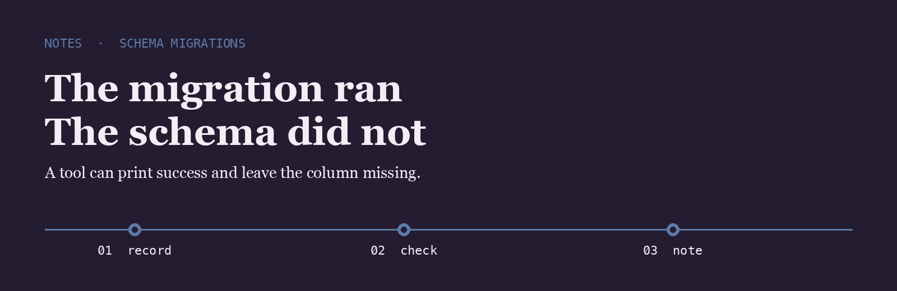
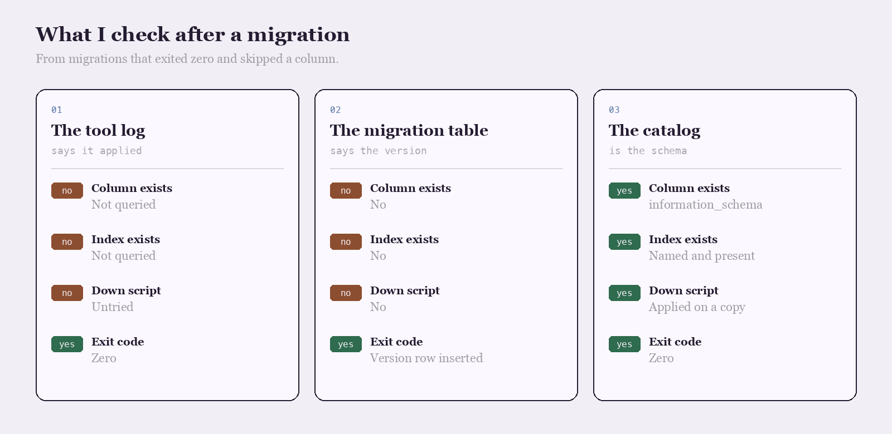

<p align="center">
  
</p>

# Ren Matsuda

I review the up and down scripts, then I query the live schema. The script log is not the schema.

## The question

After the migration printed success, did you query the column, or trust the log line?

<p align="center">
  
</p>

|  | The tool log | The migration table | The catalog |
| --- | --- | --- | --- |
| Column exists | Not queried | No | information_schema |
| Index exists | Not queried | No | Named and present |
| Down script | Untried | No | Applied on a copy |
| Exit code | Zero | Version row inserted | Zero |

## The line I keep

The line I write after the catalog matches the script.

```text
2026-04-11  migrate  version 48  column orders.packed_at  index orders_packed_at_idx  down tested on a copy
```

Applying the file is solved. Checking the catalog still matches that file is not.

- [migrate](https://github.com/golang-migrate/migrate) is the runner I read when a version is marked applied
- [goose](https://github.com/pressly/goose) is the Go runner I compare the SQL files against
- [dbmate](https://github.com/amacneil/dbmate) is the small runner I use when the project is one database

I keep a fork of each on this account.

## What I pay attention to

- Columns checked in the catalog
- Down scripts tried on a copy
- Version rows that match a real column
- One database per small project

## Working with me

Send a short problem statement, a way to see it happen, and what done looks like. I am independent, remote, and usually around during the Tokyo evening.
